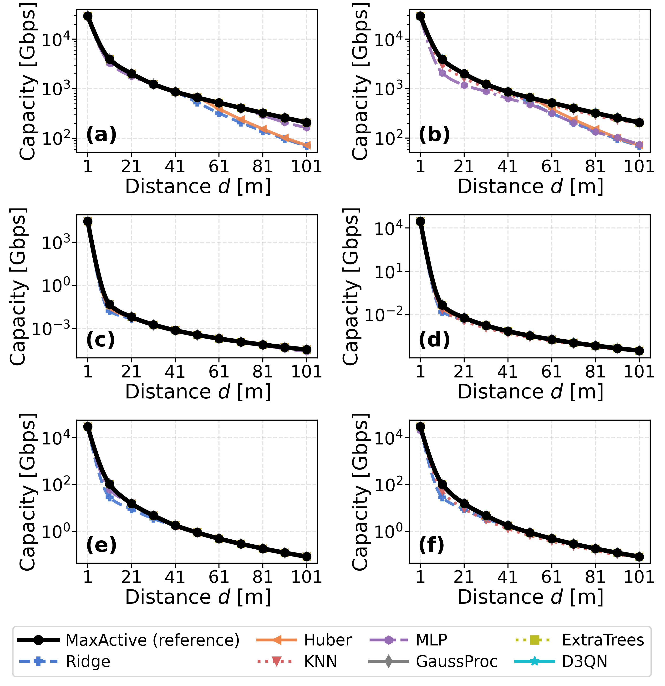
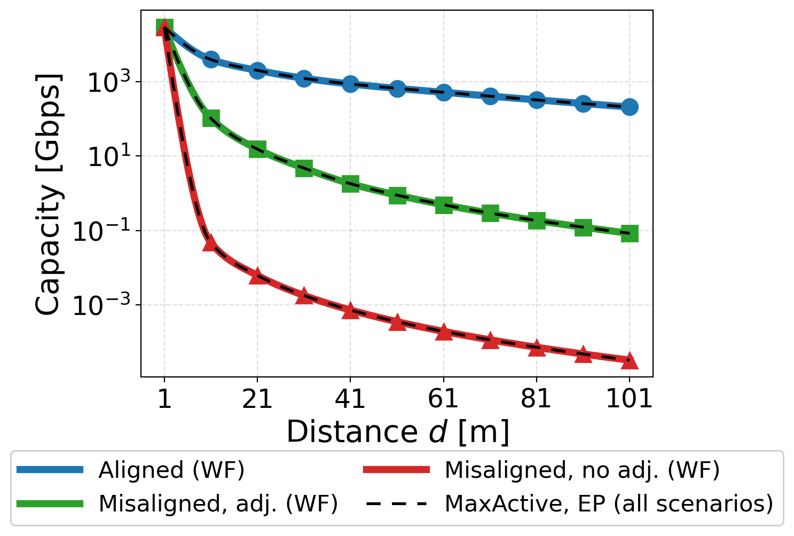
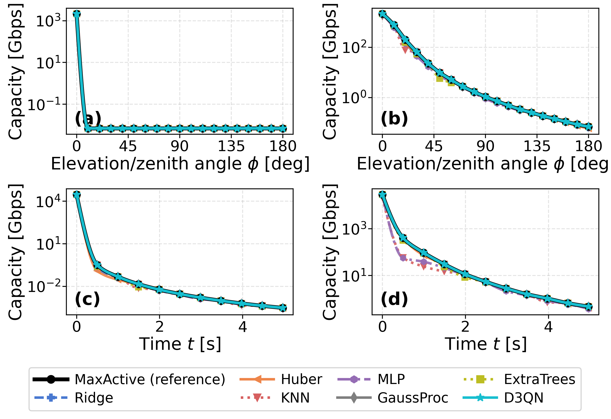

# Machine-Learning Channel Selection for THz Drone-to-Drone Links

Learned low-complexity surrogates — **18 supervised regressors** and a **D3QN policy** —
for the **MaxActive** channel-selection algorithm in a Terahertz (THz) drone-to-drone
link. Everything in this repository is generated from the reference MATLAB model in
[`TVT_Codes_Matlab/`](TVT_Codes_Matlab/): the LBLRTM molecular-absorption data, the
trajectory geometry, and the physics. No value is read off a published figure.

The full pipeline — reference reproduction, supervised ML, and D3QN — lives in a single
executable notebook, [`thz_d3qn_v4.ipynb`](thz_d3qn_v4.ipynb) (90 cells, Sections A–U),
which is the authoritative deliverable. A 9-page IEEE correspondence written from its
results is in [`paper/thz_ml_maxactive.tex`](paper/thz_ml_maxactive.tex).

---

## Table of contents

- [Motivation](#motivation)
- [What is in this repository](#what-is-in-this-repository)
- [The reference model (physics)](#the-reference-model-physics)
- [Mobility patterns](#mobility-patterns)
- [Datasets and features](#datasets-and-features)
- [The 18 supervised models](#the-18-supervised-models)
- [The D3QN policy](#the-d3qn-policy)
- [Evaluation protocol](#evaluation-protocol)
- [Results](#results)
- [Runtime, memory, and deployment](#runtime-memory-and-deployment)
- [Figures](#figures)
- [Notebook map](#notebook-map)
- [Reproducing](#reproducing)
- [Building the paper](#building-the-paper)
- [Scope and limitations](#scope-and-limitations)
- [Gotchas for anyone extending this](#gotchas-for-anyone-extending-this)
- [References](#references)
- [Citation and authors](#citation-and-authors)

---

## Motivation

THz link capacity depends on distance, antenna gain, beam alignment, beamwidth,
free-space path loss, molecular absorption, noise power, and the per-channel SNR
profile. **MaxActive** picks the set of active channels by sweeping an SNR threshold
over SNR-ordered nested subsets and keeping the subset of maximum capacity. It is the
reference method here — accurate, but it must re-run on every geometry change, and its
cost scales with the number of channels (≈11,700 per context).

The question this repository answers: **can a learned model replace that online search?**
A surrogate turns a state-dependent sweep into a constant-cost evaluation with a hard
worst-case latency — attractive on an airborne platform. Measured on one core, the
MaxActive threshold sweep takes **77 ms** per context while the full surrogate path
(feature extraction + inference) takes **0.9 ms**, an ~88× reduction.

---

## What is in this repository

```
thz_d3qn_v4.ipynb                # MAIN deliverable — full pipeline, Sections A–U
README.md                        # this file

TVT_Codes_Matlab/                # reference MATLAB model + all input data
  Main_Code.m                    #   reference implementation (physics + trajectories)
  Readme.txt                     #   the three MATLAB flag variables
  LBLRTM_..._RANGE_km_*.mat      #   molecular transmittance at 11 link distances (USED)
  data_small_windy_average.mat   #   real windy-hover acceleration traces (USED)
  ITU_dist_*.mat, d*m*.mat       #   auxiliary MATLAB data (see note below)

paper/
  thz_ml_maxactive.tex           # IEEE correspondence source (IEEEtran), 9 pages
  thz_ml_maxactive.pdf           # the compiled correspondence
  *.png                          # figure copies used by the .tex

*.png                            # 17 figures generated by the notebook
```

**Note on the auxiliary `.mat` files.** `ITU_dist_*.mat` (~51 MB) is referenced by
neither the Python port nor `Main_Code.m`; it is kept for provenance with the original
MATLAB drop. The small `d*m*.mat` files are read by `Main_Code.m` only. The Python
pipeline needs exactly two things from this directory: the eleven `LBLRTM_*.mat`
transmittance files and `data_small_windy_average.mat`.

**Not tracked in git** (see [`.gitignore`](.gitignore)): the `.venv/`, LaTeX build
products, internal working notes, and the two **reference PDFs** — they are third-party
publications, cited in [References](#references) rather than redistributed. The compiled
correspondence [`paper/thz_ml_maxactive.pdf`](paper/thz_ml_maxactive.pdf) **is** tracked,
alongside its `.tex` source.

---

## The reference model (physics)

A Python port of `TVT_Codes_Matlab/Main_Code.m`, Sections A–I of the notebook.

| Quantity | Model |
|---|---|
| Path loss | Free-space spreading (Friis) + molecular absorption |
| Absorption | `τ(f) = e^{−k(f)d}`, with `k(f)` from LBLRTM transmittance data |
| Absorption noise | `P_N = k_B·T₀·(1−τ)·Δf`, `T₀ = 296 K` |
| Antenna gain | Spherical-lobe model: in-beam `4π/θ_bw²`, else side-lobe `ρ = 0.1`; Tx·Rx product along the instantaneous boresight |
| SNR / capacity | `γ_i = P_i·G/(A_i·P_{N,i})`,  `C = Σ Δf_i·log₂(1+γ_i)`,  `A_i = 10^{PL_i/10}` |
| Equal power (EP) | `P_i = P_T/\|Ω\|` |
| Water-filling (WF) | `P_i = max(0, μ − A_i·P_{N,i}/G)` |

**System parameters:** Tx power 24 dBm; band 0.75–4.4 THz (≈11,700 active channels per
context); beamwidth 10°; side-lobe level 0.1; Tx fixed, Rx moving over 11 steps. The
LBLRTM files fix the straight-trajectory distance grid to **[1, 11, 21, …, 101] m**.

The absorption data is loaded for the nearest available distance and rescaled to the
exact link range by the Beer–Lambert law (`load_lblrtm()`, Section C). Selection and
power allocation are optimized **alternately** in `distance_to_cap_opt()` (Section I):
an iterative WF ↔ MaxActive convergence loop, with optional beamwidth adjustment
(`antenna_gain_optim()`, coarse + fine search).

---

## Mobility patterns

Four patterns, each run for MaxActive-WF and MaxActive-EP, with beamwidth adjustment off
and on. Capacity spans roughly **nine decades** across them, so every capacity axis is
logarithmic.

| # | Pattern | Geometry | Behaviour |
|---|---|---|---|
| 1 | **Aligned** | straight trajectory, beams aligned | highest capacity, smooth decay |
| 2 | **Misaligned, diagonal mobility** | diagonal recession, `v = (√2·5, √2·5)` m/s, fixed beams | capacity collapses as the beams drift apart |
| 3 | **Misaligned, elevation mobility** | Rx on a constant-radius hemisphere (r = 20 m), φ swept 0°→180° | distance constant — the loss is *purely* misalignment: a sharp drop to a side-lobe plateau (no adjustment) or a gradual decline (with adjustment) |
| 4 | **Misaligned, real mobility traces** | Tx/Rx integrated from real windy-hover accelerations plus a diagonal drift, t ∈ [0, 5] s | sharp collapse then jitter |

Patterns 1–2 feed the main 33-sample study (notebook Sections N–S). Patterns 3–4 are
reproduced for MaxActive in Section M.2 and get their own ML/D3QN treatment on a
separate 60-sample dataset in Section T.

Patterns 3 and 4 reproduce Figs. 11 and 14 of the source paper in shape. Where the
MATLAB and the published figure disagree, **the MATLAB is kept** — e.g. the real-trace
scenario starts at d = 1 m (per the MATLAB initial coordinates), so its t = 0 capacity
(~29,400 Gbps) is higher than the published figure's.

---

## Datasets and features

| Dataset | Rows | Composition | Notebook |
|---|---|---|---|
| Main | **33** | 3 scenarios (aligned, diagonal-noAdj, diagonal-Adj) × 11 distances | Section N |
| Mobility | **60** | elevation (2 × 19) + real traces (2 × 11) | Section T |

**Target:** `log₁₀(MaxActive capacity in Gbps)`, fit separately for the WF and EP
allocations (two regressions, not one feature).

**13 engineered physical features** — the models never see raw channels:

`log10_dist`, `gain_norm`, `bw_norm`, `scenario_id`, `alloc_flag`, `mean_log_SNR`,
`std_log_SNR`, `mean_log_noise`, `std_log_noise`, `valid_frac`, `log_dist_sq`,
`gain_sq`, `mean_PL_norm`.

(`alloc_flag` is effectively constant within a training matrix; WF vs EP is separated by
training on two targets, not by that feature.) The **D3QN is the exception** — it
consumes the raw per-channel state.

---

## The 18 supervised models

Six families, scikit-learn + XGBoost:

| Family | Models |
|---|---|
| Linear / regularized | LinearReg (OLS), Ridge, Lasso, ElasticNet, BayesianRidge |
| Robust | Huber |
| Kernel / probabilistic | SVR-RBF, KernelRidge, GaussProc (squared-exp + white kernel) |
| Instance-based | KNN |
| Neural | MLP |
| Tree ensembles / boosting | RandomForest, ExtraTrees, Bagging, AdaBoost, GradBoost, XGBoost |
| Single tree (contrast) | DecisionTree |

**HistGradientBoosting was tested and removed** — it fails outright in this data regime
(CV R² < 0, ceiling overshoot up to ~4×10⁶%).

Hyper-parameters are grid-searched. In the authoritative nested CV, every tunable model
is tuned in an **inner 3-fold loop on the outer training partition only**, so tuning
never sees the test fold. GaussProc and BayesianRidge self-tune internally
(marginal likelihood / evidence); LinearReg has nothing to tune.

---

## The D3QN policy

A dueling double-DQN, deliberately framed as a **single-step contextual bandit, not
sequential RL**: the channel state is fixed by the geometry, the agent takes one action,
receives one reward, and the episode ends. Horizon 1, discount 0. One lightweight model
per (distance, gain) context.

| | |
|---|---|
| State | Top-500 SNR-ranked individual channels, each as `[log₁₀ APL, log₁₀ Pn]` → 1000-dim |
| Network | `1000 → 16 → 8 → [V(1), A(600)]`, dueling head — **21,561 parameters, 84 KB fp32** |
| Action | Number of selected channels; equal power; the **true physical capacity** of the choice is then evaluated |
| Reward | `r = ln((C_max − C_min) + 1) − ln((C_max − C) + 1)` |
| Training | Smooth-ℓ1 loss, ε-greedy, Adam (lr 1e-3, weight decay 1e-4), 20 epochs × 80 actions |

Because it selects channels and then measures the real capacity of that selection, the
D3QN is **≤ the MaxActive reference by construction** — unlike the regressors, which
predict a number and can overshoot.

---

## Evaluation protocol

**Optimality scope.** MaxActive is optimal *within its threshold-search family* —
SNR-ordered nested subsets, conditioned on the given power allocation. It is **not**
claimed optimal globally over all 2^|F| subsets, nor for the joint selection + power
problem. The notebook and the paper both state this scope explicitly.

**The physical-optimality clip.** Predictions are capped at `min(pred, MaxActive)` **for
offline figures only**. The clip needs the reference value, which a deployed surrogate
does not have, so it is *not* part of the online path. **Every reported metric comes from
raw, un-clipped predictions**, and the overshoot magnitudes are quantified separately.

**Nested cross-validation (Section S) is the authoritative evaluation:** outer
`RepeatedKFold(5×3) = 15` folds, inner 3-fold grid search, scaling inside the pipeline.
Run for both the WF and EP targets. 33 points cannot support a single ~8-point test set
for ranking 18 models — one split reshuffles the rankings and hides overfitting (Huber
looks best on one split but collapses to R² 0.93 under CV; OLS looks fine but is
R² −7.98). The single 75/25 split in Section Q is retained only for the illustrative
curve fits; **cite the nested-CV numbers.**

**Robust metric:** median relative error in linear Gbps alongside RMSE/R² on the log
target — MAPE explodes on the tiny far-distance capacities.

**Display vs metric:** figure curves are refit on all data (`predict_curve_full`, i.e.
the deployable estimator); reported metrics come from nested CV.

**Smoothing:** every capacity curve uses PCHIP (monotone) interpolation **in log space**,
with a marker at each truly computed point. It is display-only and fabricates nothing —
the real-trace jitter is preserved deliberately.

---

## Results

### Reference reproduction

All four mobility patterns reproduce with the expected ordering and a ~9-decade span;
the elevation and real-trace curves match the source paper's Figs. 11 and 14 in shape.

### Supervised models (nested CV, EP target)

| Tier | Models | Notes |
|---|---|---|
| **Best** | **GaussProc** (R² ≈ 0.99, median rel. err. ≈ **1.9%**), ExtraTrees (0.986, 12.1%), SVR-RBF (0.982, 7.8%), MLP (0.980), then KNN, XGBoost | smoothness-assuming models win |
| Middle | Ridge, Lasso, ElasticNet, BayesianRidge | stable R² ≈ 0.97 but biased, ~45% median rel. err. |
| **Failures** | DecisionTree, GradBoost (ceiling overshoot ~3000–3700%), Huber (CV-unstable, R² 0.93), **LinearReg worst at CV R² ≈ −7.98** | |

**WF vs EP agree.** Nested CV was run for both targets; RMSE differs by **≤ 0.055 across
all 18 models** (≤ 0.02 for all but DecisionTree), consistent with WF ≈ EP capacity at
THz. The paper therefore tabulates EP only, and says so.

**Mobility dataset (elevation + real traces):** XGBoost 0.07%, GradBoost 0.7%,
GaussProc 2.8%, Huber 4.4% median relative error. ⚠️ This is an **in-sample** fit — it
flatters GradBoost, which fails under CV. Always qualify it when quoting.

### D3QN

Reproduces MaxActive-EP to within ~0.1% **on the mean ratio** for all seven scenario
variants (aligned 99.9%, the six misaligned 100.0%). The **worst single operating point
is 99.7%**, out of 93 geometries (33 main + 60 mobility); it never exceeds the ceiling.
Quote the mean and the worst point separately — an unqualified "within 0.1% everywhere"
is wrong at the per-point level.

### The methodological takeaway

On smooth, wide-dynamic-range, small-sample data, smoothness-assuming models win, and
generalization must be judged by nested CV rather than a single split. The best models
(GaussProc, kernel methods) also carry the highest asymptotic complexity — which does
not bind at this sample size.

---

## Runtime, memory, and deployment

Measured in notebook Section U on an i7-13620H, 1 core, |F| ≈ 11,700 channels/context,
from the committed 2026-08-09 run. The benchmark isolates the *decision* cost given a
shared channel state.

| Path | Cost |
|---|---|
| MaxActive threshold sweep | **77 ms** |
| Full link update | 95 ms (11 aligned contexts); on the 3 contexts where both were timed, adding the beamwidth search gives 72 → 91 ms, i.e. 1.3× |
| Surrogate: feature extraction | 0.84 ms |
| Surrogate: inference | 21–43 µs |
| **Surrogate end-to-end** | **0.9 ms (~88×)** |
| D3QN | shared SNR ranking 0.55 ms + forward pass 0.05 ms; 0.11 s training per context |

The model evaluation alone is 1800–3700× faster than the sweep, so **feature extraction,
not inference, now dominates** the surrogate path — that is the next optimization target.
Tree ensembles are the exception (3.0–12 ms/predict → only 6–20×).

> ⚠️ **Timings are the only non-reproducible numbers here and they vary several-fold with
> machine load** — the same sweep has measured 77–81 ms (idle), 118–134 ms (lightly
> loaded) and 623 ms (contended) across runs of identical code. Memory footprints, parameter counts and every accuracy metric are
> bit-identical across runs. Benchmark on an idle machine before quoting these.

**Memory:** linear 1.2–2.2 KB · SVR 4.6 KB · GaussProc 17.9 KB · MLP 70 KB ·
D3QN 84 KB (21 KB at 8-bit) · XGBoost 522 KB · ExtraTrees 1.4 MB.

**Asymptotics:** MaxActive `O(Q·|F|)` per step, no training. Linear `O(nd²)` train /
`O(d)` predict; trees `O(T·nd·log n)` / `O(T·depth)`; kernel/GP `O(n²–n³)` train with
`O(n²)` memory.

**Recommendation:** GaussProc where accuracy dominates; D3QN where the selection *mask*
is needed; tree ensembles offline only. At n ≤ 60 the asymptotic penalty is invisible
(GaussProc trains in 14 ms) so pick the most accurate — as n grows toward 10⁴–10⁶ the
cubic kernel cost binds and tree ensembles take over. *Kernel methods while the dataset
is small, tree ensembles once it is not.*

---

## Figures

All 17 figures are regenerated by a full notebook run. Three are used by the paper and
are authored at their **final printed size** (IEEE textwidth 7.16 in) with journal-scale
fonts — see [Gotchas](#gotchas-for-anyone-extending-this).

### Paper figures

**`all_methods_comparison.png`** — one representative per model family (Ridge, Huber,
k-NN, MLP, GaussProc, ExtraTrees) plus D3QN against MaxActive, over the aligned and
diagonal scenarios × WF/EP, evaluated at the ceiling. The full 18-model comparison is
tabulated rather than plotted, which keeps the panels legible.



**`maxactive_reference_single.png`** — the MaxActive reference: three scenarios on one
log axis (they occupy disjoint decades), WF in thick colour with the EP overlay dashed.



**`ml_mobility_comparison.png`** — elevation and real-trace mobility, EP only (WF is
omitted because it coincides with EP). Same family representatives as Fig. 1.



### Notebook-only figures

`maxactive_capacity_3panel.png` (older 3-panel reference) · `maxactive_elevation.png` ·
`maxactive_real_traces.png` · `ml_elevation_comparison.png` · `ml_real_comparison.png` ·
`cv_rmse_ranking.png` (nested-CV RMSE ranking with error bars) · `learning_curves.png`
(data efficiency by family; computed but unused) · `d3qn_v4_comparison.png` ·
`d3qn_v4_ratio_and_channels.png` · `d3qn_v4_capacity_gap.png` ·
`d3qn_v4_scatter_heatmap.png` · `ml_metrics_comparison.png` · `ml_scatter_WF.png` ·
`feature_importance.png`.

---

## Notebook map

`thz_d3qn_v4.ipynb`, 90 cells, Sections A–U.

| Section | Contents |
|---|---|
| **A** | Imports/setup; `MAT_DIR` → `TVT_Codes_Matlab/` |
| **A.1** | `slog()`, `_smooth_log()`, `_mk_ls()` — PCHIP log-space smoothing used by every curve figure |
| **B** | System parameters |
| **C** | `load_lblrtm()` — transmittance loading + Beer–Lambert rescaling (cached) |
| **D** | dB helpers, `coord2theta_phi`, `acute_angle`, `boresight_calc`, `AEmodel`, `total_antenna_gain_dB`, `delta_freq_hz`, `noise_power` |
| **E** | `mask_cap()` — Shannon capacity over the active set |
| **F** | `water_filling_algo()` |
| **G** | `active_freq_mask()` — **MaxActive** |
| **H** | `antenna_gain_optim()` — beamwidth optimization |
| **I** | `distance_to_cap_opt()` — master per-context function, WF ↔ MaxActive loop |
| **J–K** | Trajectory setup and the 3 base scenarios × 2 allocations |
| **L** | Both reference figures |
| **M** | Validation asserts + the capacity summary table |
| **M.2** | `a2vd()`, `make_elevation_traj()`, `make_real_traj()`, `run_traj_maxactive()` — the elevation and real-trace patterns (MaxActive only) |
| **N** | 33-sample dataset, `build_subband_state_v2()`, `build_features_v2()` |
| **O / O.2** | D3QN training and diagnostics |
| **P** | Supervised ML — 8 models + an extended cell adding 11 more → 18 |
| **Q** | Single-split training, all-methods figure, metrics, scatter, feature importances |
| **S** | **Nested cross-validation — the authoritative metrics** (`CV_MODELS`, `_make_cv_est()`) |
| **R** | Clip explanation, overshoot analysis, per-model rationale |
| **T** | The same 18 models + D3QN on the 60-sample mobility dataset |
| **U** | Runtime and memory benchmark → `runtime_bench` |

The physical order in the notebook is Q, then S, then R.

---

## Reproducing

Requirements: **Python 3.13** (developed on 3.13.5).

```bash
python -m venv .venv
# Windows:        .venv\Scripts\activate
# macOS / Linux:  source .venv/bin/activate

pip install numpy scipy matplotlib h5py scikit-learn xgboost torch nbconvert
```

Versions used for the committed run:

| Package | Version |
|---|---|
| numpy | 2.4.4 |
| scipy | 1.17.1 |
| matplotlib | 3.10.8 |
| h5py | 3.16.0 |
| scikit-learn | 1.8.0 |
| xgboost | 3.2.0 |
| torch | 2.11.0 |
| nbconvert | 7.17.0 |

Execute the whole pipeline and regenerate every figure:

```bash
python -m nbconvert --to notebook --execute --inplace thz_d3qn_v4.ipynb
```

**~6 minutes wall clock** on an idle machine. Measured sub-steps: the three base
scenarios × 2 allocations ≈ 7 s, D3QN training over 33 contexts 6.2 s, nested CV
29.7 s. The bulk of the time is
the beamwidth-optimizing physics sweeps in Sections M.2/T (60 mobility contexts, each
running `antenna_gain_optim`) plus the Section U benchmark.

Everything is deterministic under fixed seeds **except** the Section U wall-clock
timings, which move ±10% with machine load. The committed notebook is a clean in-order
run (execution counts 1→55, zero errors).

---

## Building the paper

```bash
cd paper
pdflatex thz_ml_maxactive.tex   # run twice; latexmk is unavailable on the dev machine
pdflatex thz_ml_maxactive.tex
```

The compiled PDF is tracked, so rebuild only when the `.tex` or a figure changes, and
commit the regenerated PDF with it. The source compiles with **IEEEtran** (the IEEEtaes class
was unavailable offline, but the body maps 1:1 to the TAES template). It has nine
sections, 3 figures and 5 tables: key formulas, MaxActive capacities, the nested-CV
ranking with ceiling violations merged in, per-scenario error, and asymptotic + measured
complexity.

Every number in the paper traces to a notebook cell — audited value by value. The only
non-deterministic values are the Section U timings, which live in **preamble macros**
(`\PLNCH`, `\PLMASEL`, `\PLMASTEP`, `\PLMASTEPBW`, `\PLPREDUS`) so a re-run needs one
edit in one place. Those macros already contain `$...$`: write `\PLMASEL{}`, **never**
`$\PLMASEL$`.

Other LaTeX traps, in case you edit it:

- Page numbers are bottom-right via `fancyhdr`; the title page needs
  `\thispagestyle{plain}` right after `\maketitle`, because `\maketitle` installs
  IEEEtran's own `IEEEtitlepagestyle`.
- `placeins` is loaded but `\FloatBarrier` is deliberately **not** used — it hurt
  packing. Float placement is tuned via `\dbltopfraction`, `\dblfloatpagefraction`, and
  `dbltopnumber` instead; without those the double-column figures get banished to sparse
  float pages.
- Table III is `\scriptsize` with `\tabcolsep` 2.5 pt. At `\footnotesize` it overflows
  the column by ~27 pt and bleeds into the neighbour. After editing any table, grep the
  log for `Overfull \hbox`.
- The page count is float-sensitive.

---

## Scope and limitations

Intentionally **not** implemented:

- The **CFB and STD** channel-selection variants — MaxActive only.
- A **single distance-generalizing D3QN policy** — the agents here are per-context bandits.
- ML prediction of the **selection mask** — only the capacity value is regressed. (The
  D3QN does produce a selection.)
- **Larger or more diverse datasets** — fixed at 33 + 60 points. The elevation and
  real-trace patterns are kept as a separate 60-sample dataset rather than merged into
  the main study.

The honest caveats: the datasets are small by ML standards (which is why nested CV, not
a single split, decides every ranking); the mobility-dataset numbers quoted above are
in-sample; and the D3QN result demonstrates that a learned policy can recover a
single-step decision, not that deep RL solved a hard sequential problem.

---

## Gotchas for anyone extending this

- **`t0data01` rebinds the global boresight variables** `tTxBS, pTxBS, tRxBS, pRxBS` to
  the last mobility scenario. Any later cell needing the aligned/diagonal geometry must
  recompute it with `boresight_calc(CoordTx_init, CoordRx_init)` — Section U does.
- **Paper figures must be authored at printed size** (7.16 in textwidth; labels 12 pt,
  ticks 10.5 pt, legend 9.2 pt — the single-column reference figure uses 19/16/14.5 pt
  because it prints at half width). Authoring at a 15-in figsize shrinks the fonts ~4×
  on inclusion, rendering them at ~3.5 pt.
- **Elevation r = 20 m** and the **diagonal real-trace drift** come from the MATLAB
  configuration (`GenHemSphCoord`; `StraightDiagonalFlag = 1`), not from the paper.
- **Timing numbers are not deterministic** — re-sync the five `\PL*` macros after any
  re-run.
- **PCHIP smoothing is display-only**; the markers show the true computed points.
- The Section R markdown heading still reads "(20 models)"; the current count is **18**
  (HistGB removed).

---

## References

Neither PDF is redistributed in this repository.

1. *Joint Resource Allocation for Terahertz Band Drone Communications* (June 2024) — the
   source paper. Its Figs. 11 and 14 correspond to the elevation and real-trace mobility
   patterns reproduced here.
2. The D3QN reference paper informing the dueling double-DQN design.
3. LBLRTM — Line-By-Line Radiative Transfer Model, the origin of the molecular
   transmittance data in `TVT_Codes_Matlab/`.

---

## Citation and authors

- **Korhan Erdoğdu** — main contributor, Sabancı University
- **Özgür Gürbüz** — Professor, Sabancı University (supervised)
- **Akhtar Saeed** — Assistant Professor, Kadir Has University (supervised)
- **Mikail Erdem** — Postdoctoral Researcher and Instructor, Sabancı University

*Machine-Learning Surrogates for MaxActive Channel Selection in Terahertz Drone-to-Drone
Communications*, IEEE correspondence — source in
[`paper/thz_ml_maxactive.tex`](paper/thz_ml_maxactive.tex), compiled PDF in
[`paper/thz_ml_maxactive.pdf`](paper/thz_ml_maxactive.pdf).
