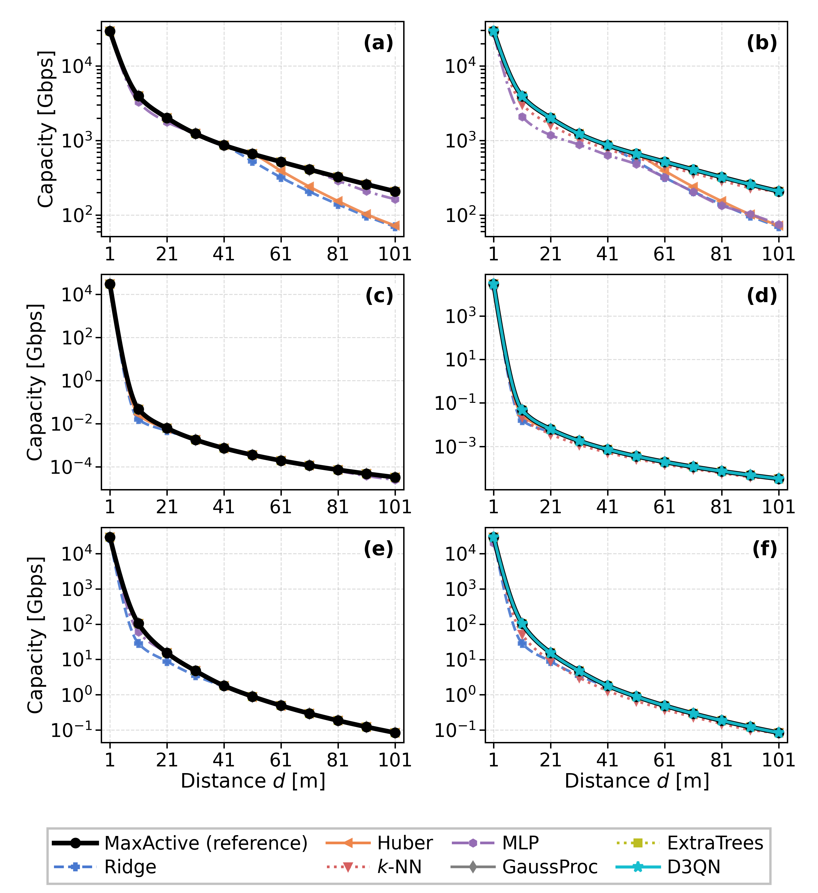
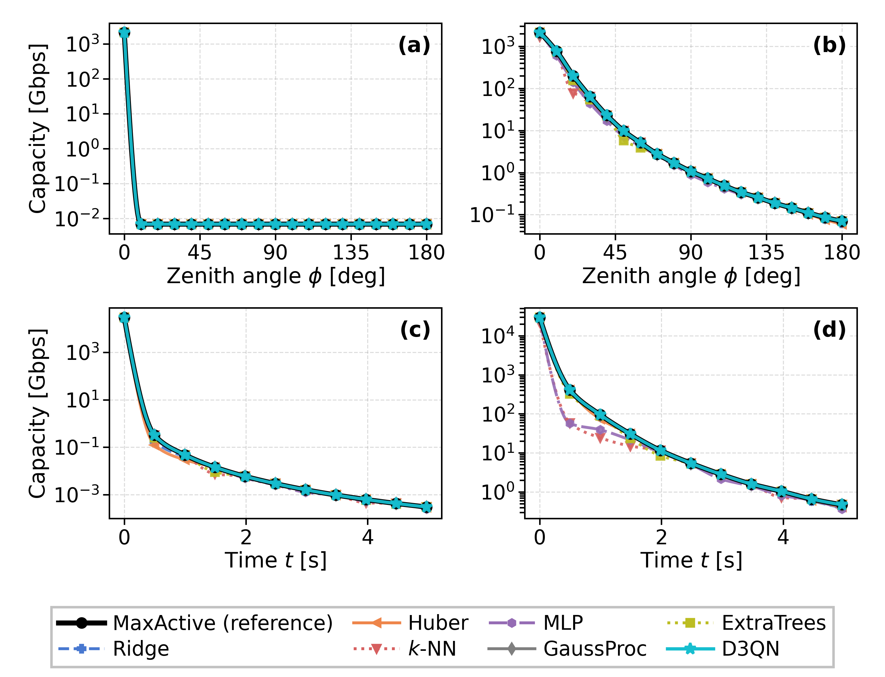

# Machine Learning Based Spectrum Allocation for THz UAV Communications

Machine-learning alternatives for **spectrum allocation (channel selection)** in Terahertz
(THz) links between unmanned aerial vehicles (UAVs). In this band, molecular absorption
splits the spectrum into frequency-dependent transmission windows, and mobility misaligns
the narrow beams. The existing threshold-search method, **MaxActive**, returns the best
channel set within its search family, but it must repeat a search over ≈11,700 channels
at every geometry update. This repository studies two learned alternatives that work
from the same physical channel state:

- **18 supervised regressors** (six model families) that predict the capacity the search
  would deliver;
- a **D3QN policy**, formulated as a single-step contextual bandit, that learns the
  channel-selection decision itself.

Everything is generated from the reference MATLAB model in
[`TVT_Codes_Matlab/`](TVT_Codes_Matlab/): the LBLRTM molecular-absorption data, the
trajectory geometry, and the physics. **No value is read off a published figure.**

- **Code and results:** a single executable notebook,
  [`thz_d3qn_v4.ipynb`](thz_d3qn_v4.ipynb) (90 cells, Sections A–U).
- **Paper:** a manuscript for the IEEE Open Journal of Vehicular Technology (OJVT) in
  [`paper_ojvt/`](paper_ojvt/), with the compiled [`ojvt.pdf`](paper_ojvt/ojvt.pdf).
  The earlier TAES Correspondence version is kept in [`paper_taes/`](paper_taes/).

---

## Table of contents

- [Motivation](#motivation)
- [What is in this repository](#what-is-in-this-repository)
- [The reference model (physics)](#the-reference-model-physics)
- [Mobility patterns](#mobility-patterns)
- [Datasets and features](#datasets-and-features)
- [The 18 supervised models](#the-18-supervised-models)
- [The D3QN policy](#the-d3qn-policy)
- [Evaluation protocol](#evaluation-protocol)
- [Results](#results)
- [Runtime, memory, and deployment](#runtime-memory-and-deployment)
- [Figures](#figures)
- [Notebook map](#notebook-map)
- [Reproducing](#reproducing)
- [Building the paper](#building-the-paper)
- [Scope, limitations, and open items](#scope-limitations-and-open-items)
- [Gotchas for anyone extending this](#gotchas-for-anyone-extending-this)
- [References](#references)
- [Citation and authors](#citation-and-authors)

---

## Motivation

THz link capacity depends on distance, molecular absorption and absorption noise,
antenna gain, beamwidth and beam alignment, the selected channels, and the power
allocation. Which channels to activate, and how to share the transmit power among them,
therefore decides the achievable capacity: this is the **spectrum allocation problem**.

**MaxActive** [1] solves it by sweeping an SNR threshold over SNR-ordered nested channel
subsets and keeping the subset of maximum capacity. It is the reference solution here,
but the search is repeated at every geometry change, and its cost scales with the number
of channels. A prior study [2] replaced it with a D3QN policy.

**This work asks:**
- Can simpler supervised models, trained on the same physical channel state, predict what
  the search achieves?
- What does each alternative cost in accuracy, physical feasibility, run time, memory, and
  training effort?

Measured on one core, the MaxActive threshold sweep takes **77 ms** per context, while a
regressor's full online path (feature extraction + inference) takes **0.9 ms**, an
~88× reduction.

---

## What is in this repository

```
thz_d3qn_v4.ipynb                # MAIN code deliverable — full pipeline, Sections A–U
README.md                        # this file

TVT_Codes_Matlab/                # reference MATLAB model + all input data
  Main_Code.m                    #   reference implementation (physics + trajectories)
  Readme.txt                     #   the three MATLAB flag variables
  LBLRTM_..._RANGE_km_*.mat      #   molecular transmittance at 11 link distances (USED)
  data_small_windy_average.mat   #   real windy-hover acceleration traces (USED)
  ITU_dist_*.mat, d*m*.mat       #   auxiliary MATLAB data (see note below)

paper_ojvt/                      # THE paper — IEEE OJVT manuscript (14 pages)
  ojvt.tex                       #   LaTeX source
  ojvt.pdf                       #   compiled manuscript
  References.bib                 #   28 verified BibTeX references (DOI or URL for each)
  ieee-ojvt.cls, ojvt-logo.png   #   official OJVT template files (unmodified)
  figures/                       #   copies of the three paper figures below

paper_taes/                      # previous version — IEEE TAES Correspondence (15 pages)
  thz_ml_spectrum_allocation.tex #   LaTeX source
  thz_ml_spectrum_allocation.pdf #   compiled manuscript
  references.bib                 #   bibliography of the TAES version
  IEEEtaes.cls, IEEEtaes.bst     #   official TAES template files (unmodified)
  REVISION_NOTES.md              #   change log and open issues of the Oct 2026 revision
  figures/                       #   source of the paper figures (re-plot script + data)
    maxactive_reference_single.png   # Fig. 1 (notebook output, unchanged)
    fig_capacity_main.pdf/.png       # Fig. 2
    fig_capacity_mobility.pdf/.png   # Fig. 3
    fig_data.npz                     # the exact arrays plotted in Figs. 2–3
    replot_paper_figures.py          # presentation-only re-plot of Figs. 2–3

*.png                            # 17 figures generated by the notebook
```

**Note on the auxiliary `.mat` files.**
- The Python pipeline needs exactly two things from `TVT_Codes_Matlab/`: the eleven
  `LBLRTM_*.mat` transmittance files and `data_small_windy_average.mat`.
- `ITU_dist_*.mat` (~51 MB) is used by neither the Python port nor `Main_Code.m`; it is
  kept for provenance with the original MATLAB drop.
- The small `d*m*.mat` files are read by `Main_Code.m` only.

**Not tracked in git** (see [`.gitignore`](.gitignore)): `.venv/`, LaTeX build products,
internal working notes, template archives, and the two **reference PDFs**. The reference
PDFs are third-party publications, so they are cited in [References](#references) rather
than redistributed.

---

## The reference model (physics)

A Python port of `TVT_Codes_Matlab/Main_Code.m`, notebook Sections A–I; Section II of the
paper develops it in full.

| Quantity | Model |
|---|---|
| Spreading loss | Friis: `20 log₁₀ d + 20 log₁₀ f[MHz] − 27.55` dB |
| Absorption | Beer–Lambert transmittance `τ(f,d) = e^{−k(f)d}`, `k(f)` from LBLRTM data |
| Absorption noise | `P_N = k_B·T₀·(1−τ)·Δf`, `T₀ = 296 K` |
| Antenna gain | Spherical-lobe model: in-beam `4π/ψ²`, else side-lobe `ρ = 0.1`; total `G = G_Tx·G_Rx` along the instantaneous line of sight vs fixed boresights |
| SNR / capacity | `γ_i = P_i·G/(A_i·P_{N,i})`,  `C = Σ_{i∈Ω} Δf_i·log₂(1+γ_i)` |
| Equal power (EP) | `P_i = P_T/\|Ω\|` |
| Water-filling (WF) | `P_i = max(0, μ − A_i·P_{N,i}/G)` |

**Problem.** Maximize `C(Ω, {P_i})` over the channel set Ω, the powers, and the beamwidth
ψ, subject to `Σ P_i ≤ P_T`. The search space is combinatorial (2^|F| subsets).
Following [1], beamwidth is adjusted first, then selection and power allocation are
alternated until the channel set is stable (`distance_to_cap_opt()`, Section I).

**System parameters** (from the MATLAB code):
- Tx power 24 dBm.
- Band 0.75–4.4 THz: 11,699 channels of ≈0.312 GHz.
- Beamwidth 10°, side-lobe level 0.1.
- Horizontal path at 100 m altitude.
- The LBLRTM files fix the straight-trajectory distance grid to **[1, 11, 21, …, 101] m**.
  Other ranges are rescaled by the Beer–Lambert law (`load_lblrtm()`, Section C).

---

## Mobility patterns

Four patterns, each run for MaxActive-WF and MaxActive-EP, with beamwidth adjustment off
and on. Across them capacity spans roughly **nine decades**, so every capacity axis is
logarithmic.

| # | Pattern | Geometry | Behaviour |
|---|---|---|---|
| 1 | **Aligned** | straight trajectory, beams aligned | highest capacity, smooth decay |
| 2 | **Misaligned, diagonal mobility** | diagonal recession, `v = (5√2, 5√2, 0)` m/s, fixed beams | capacity collapses as the beams drift apart |
| 3 | **Misaligned, elevation mobility** | Rx on a constant-radius hemisphere (r = 20 m), zenith angle φ swept 0°→180° | distance constant, so the loss is *purely* misalignment: a sharp drop to a side-lobe plateau (no adjustment) or a gradual decline (with adjustment) |
| 4 | **Misaligned, real mobility traces** | Tx/Rx integrated from real windy-hover accelerations plus a diagonal drift, t ∈ [0, 5] s | sharp collapse, then jitter |

Patterns 1–2 feed the main 33-sample study (notebook Sections N–S). Patterns 3–4 are
reproduced for MaxActive in Section M.2 and get their own ML/D3QN treatment on a
separate 60-sample dataset in Section T.

Where the MATLAB result and a published figure of [1] disagree, **the MATLAB is kept**.
For example, the real-trace scenario starts at d = 1 m (per the MATLAB initial
coordinates), so its t = 0 capacity (~29,400 Gbps) is higher than in the published
figure.

---

## Datasets and features

| Dataset | Rows | Composition | Notebook |
|---|---|---|---|
| Main | **33** | 3 scenarios (aligned, diagonal no-adj, diagonal adj) × 11 distances | Section N |
| Mobility | **60** | elevation (2 × 19) + real traces (2 × 11) | Section T |

**Target:** `log₁₀(MaxActive capacity in Gbps)`, fit separately for WF and EP (two
regressions).

**13 engineered physical features.** The regressors never see raw channels. The band is
split into 20 equal sub-bands, and the features are:
- **Geometry and antenna:** `log₁₀(d+1)` and its square; total gain `G_dB/60` and its
  square; beamwidth `ψ/360°`.
- **Channel quality:**
  - mean and standard deviation over sub-bands of a **received-power indicator**
    `Π_k = log₁₀(P_T·G/Ā_k)` (labelled `mean_log_SNR`/`std_log_SNR` in the code, but it
    has no noise term);
  - mean and standard deviation of the log absorption noise;
  - normalized mean path loss;
  - the fraction of non-empty sub-bands.
- **Context labels:** a scenario index and an allocation flag. The flag is constant per
  training set, because WF and EP are separate targets.

The **D3QN is the exception**: it consumes the per-channel state.

---

## The 18 supervised models

Six families, scikit-learn + XGBoost:

| Family | Models |
|---|---|
| Linear / regularized | LinearReg (OLS), Ridge, Lasso, ElasticNet, BayesianRidge |
| Robust | Huber |
| Kernel / probabilistic | SVR-RBF, KernelRidge, GaussProc (squared-exp + white kernel) |
| Instance-based | k-NN |
| Neural | MLP |
| Tree ensembles / boosting | RandomForest, ExtraTrees, Bagging, AdaBoost, GradBoost, XGBoost |
| Single tree (contrast) | DecisionTree |

**HistGradientBoosting was tested and removed.** It fails in this data regime (negative
CV R²).

**Hyper-parameter tuning.** In the nested CV, every tunable model is grid-searched in an
**inner 3-fold loop on the outer training partition only**. The grids are listed in
Table II of the paper. GaussProc and BayesianRidge self-tune (marginal likelihood /
evidence), and LinearReg has nothing to tune.

A regressor outputs a capacity **value**, not a channel set.

---

## The D3QN policy

A dueling double-DQN after [2], framed as a **single-step contextual bandit, not
sequential RL**. The channel state is fixed by the geometry; the agent takes one action,
receives one reward, and the episode ends (horizon 1, discount 0, so no target network
is needed). One lightweight model is trained per (distance, gain) context.

| | |
|---|---|
| State | Top-500 SNR-ranked individual channels, each `[log₁₀ A, log₁₀ P_N]` → 1000-dim |
| Network | `1000 → 16 → 8 → [V(1), A(600)]`, dueling head: **21,561 parameters, 84 KB fp32** |
| Action | Number of top-ranked channels to activate (600 actions: 1..50 individually, then 550 evenly spaced). EP; the **true physical capacity** of the choice is evaluated |
| Reward | `r = ln((C_max − C_min) + 1) − ln((C_max − C) + 1)`, where `C_max` = the context's MaxActive-EP capacity, `C_min = 0`, in bit/s |
| Training | 20 epochs × 80 ε-greedy actions (ε 1.0 → 0.02); one replay minibatch of 64 per epoch; smooth-ℓ1 loss; Adam (lr 1e-3, weight decay 1e-4); gradient clip 1.0 |
| Output | The greedy action, **unless an action already evaluated during training gave a higher capacity** (paper eq. 16) |

Because it selects channels and the real capacity of that selection is then computed, the
D3QN cannot exceed the best SNR-ordered prefix, unlike the regressors, which predict a
number and can overshoot.

---

## Evaluation protocol

**Optimality scope.** MaxActive is optimal *within its threshold-search family*
(SNR-ordered nested subsets), conditioned on the given power allocation. It is **not**
claimed optimal over all 2^|F| subsets, nor for the joint selection + power problem.

**The display clip.** Plotted regressor curves are capped at `min(pred, MaxActive)` **for
figures only**. A deployed regressor has no access to the reference, so **every reported
metric comes from raw, un-clipped predictions**, and the overshoot is reported
separately.

**Nested cross-validation (Section S) is the authoritative evaluation.**
- Outer `RepeatedKFold(5×3) = 15` folds; inner 3-fold grid search; scaling inside the
  pipeline.
- Run for both the WF and EP targets.
- Why not a single split: 33 points cannot support one ~8-point test set for ranking 18
  models. On a single 75/25 split, Huber is second only to GaussProc but falls to R² 0.93
  under CV; OLS looks fine (R² 0.991) but scores R² −7.98 under CV.
- The single split (Section Q) is kept only for illustration. **Cite the nested-CV
  numbers.**

**Robust metric:** median relative error in linear Gbps, alongside RMSE and R² on the log
target. MAPE explodes on the tiny far-distance capacities.

**Smoothing:** every capacity curve uses PCHIP (monotone) interpolation **in log space**,
with a marker at each computed point. It is display-only.

---

## Results

### Reference reproduction

All four mobility patterns reproduce with the expected ordering (aligned > adjusted >
non-adjusted) and a ~9-decade span. WF and EP capacities nearly coincide.

### Supervised models (nested CV, EP target)

| Tier | Models | Notes |
|---|---|---|
| **Best** | **GaussProc** (R² ≈ 0.99, median rel. err. ≈ **1.9%**), ExtraTrees (0.986, 12.1%), SVR-RBF (0.982, 7.8%), MLP (0.980), then k-NN, XGBoost | smoothness-assuming models win |
| Middle | Ridge, Lasso, ElasticNet, BayesianRidge | stable R² ≈ 0.97 but biased, ~45% median rel. err. |
| **Failures** | DecisionTree, GradBoost (ceiling overshoot ~3000–3700%), Huber (CV-unstable, R² 0.93), **LinearReg worst at CV R² ≈ −7.98** | |

**Every regressor exceeds the physical bound at one or more points.** How large that
violation is matters as much as the average error; see Table IV of the paper.

**WF and EP agree.** Nested CV was run for both targets; RMSE differs by **≤ 0.055 across
all 18 models**. The paper therefore tabulates EP only.

**Mobility dataset (elevation + real traces):** XGBoost 0.07%, GradBoost 0.7%,
GaussProc 2.8%, Huber 4.4% median relative error. ⚠️ This is an **in-sample** fit: it
flatters GradBoost, which fails under CV.

### D3QN

The D3QN reaches **≥ 99.7% of MaxActive-EP at every one of the 93 geometries** (33 main
+ 60 mobility):
- mean ratio 99.9% in the aligned case and 100.0% in the six misaligned cases;
- it never exceeds the reference.

How to read these numbers:
- The chosen channel counts can differ from MaxActive's by up to 30 channels, at
  near-equal capacity.
- The reward uses the reference capacity.
- The reported decision includes the training-time fallback (output rule above).

So the figures describe the full training-plus-selection procedure, not the greedy
network alone.

### The methodological takeaway

- On smooth, wide-dynamic-range, small-sample data, smoothness-assuming models win.
- Generalization must be judged by nested CV, not a single split.
- Learning the *decision* is safer than learning its *value*: a policy reports only
  capacities a real allocation delivers.

---

## Runtime, memory, and deployment

Measured in notebook Section U on an i7-13620H, 1 core, |F| ≈ 11,700 channels per
context, from the committed run.

| Path | Cost |
|---|---|
| MaxActive threshold sweep | **77 ms** |
| Full link update | 95 ms (11 aligned contexts). On the 3 contexts where both were timed, adding the beamwidth search raises it from 72 to 91 ms (1.3×) |
| Regressor: feature extraction | 0.84 ms |
| Regressor: inference | 21–43 µs |
| **Regressor end-to-end** | **0.9 ms (~88×)** |
| D3QN | shared SNR ranking 0.55 ms + forward pass 0.05 ms; **0.11 s training per context** |

- **Feature extraction, not inference, dominates** the regressor path: the model
  evaluation alone is 1800–3700× faster than the sweep.
- Tree ensembles are the exception: 3.0–12 ms per prediction, so only 6–20× faster.
- Training one D3QN context costs more than one sweep and needs that context's reference
  capacity. The D3QN therefore saves computation only for contexts that recur.

> ⚠️ **Timings are the only non-reproducible numbers, and they vary several-fold with
> machine load.** The same sweep has measured 77–81 ms (idle), 118–134 ms (lightly
> loaded) and 623 ms (contended). Memory footprints, parameter counts and every accuracy
> metric are bit-identical across runs.

**Memory:** linear 1.2–2.2 KB · SVR 4.6 KB · GaussProc 17.9 KB · MLP 70 KB ·
D3QN 84 KB · XGBoost 522 KB · ExtraTrees 1.4 MB.

**Asymptotics:** MaxActive `O(Q·|F|)` per step, no training. Linear `O(nd²)` train /
`O(d)` predict; trees `O(T·nd·log n)` / `O(T·depth)`; kernel/GP `O(n²–n³)` train with
`O(n²)` memory.

**Recommendation:**
- GaussProc where accuracy dominates.
- D3QN where the channel set is needed (subject to per-context training).
- Tree ensembles offline only.

At n ≤ 60 the asymptotic penalty is invisible (GaussProc trains in 14 ms). *Kernel
methods while the dataset is small, tree ensembles once it is not.*

---

## Figures

The notebook regenerates all 17 PNG figures in the repository root.

### Paper figures (`paper_taes/figures/`, copied unchanged to `paper_ojvt/figures/`)

- **Fig. 1, `maxactive_reference_single.png`:** the MaxActive reference. Three scenarios
  on one log axis; WF thick and coloured, with EP dashed on top. Byte-identical to the
  notebook output.
- **Fig. 2, `fig_capacity_main.pdf`:** one representative per regressor family (Ridge,
  Huber, k-NN, MLP, GaussProc, ExtraTrees) plus the D3QN against MaxActive, over the
  aligned and diagonal scenarios, for WF and EP.
- **Fig. 3, `fig_capacity_mobility.pdf`:** the same representatives on the elevation and
  real-trace patterns, EP only.

**How Figs. 2 and 3 were made.** They are presentation-only re-plots, at printed size
(4.9 in, 8–8.5 pt text), of `fig_data.npz`. That file holds the exact arrays plotted by
notebook cells `4818a43f` and `t0comb01`. It was dumped from a copy of the notebook whose
outputs matched the committed notebook cell for cell, and whose regenerated PNGs were
pixel-identical. To restyle, edit `replot_paper_figures.py` and run it; it never trains,
simulates, or evaluates anything. After a re-plot, copy the new PDFs into
`paper_ojvt/figures/`.





### Notebook-only figures (repository root)

`all_methods_comparison.png` and `ml_mobility_comparison.png` (the earlier versions of
Figs. 2–3) · `maxactive_capacity_3panel.png` · `maxactive_elevation.png` ·
`maxactive_real_traces.png` · `ml_elevation_comparison.png` · `ml_real_comparison.png` ·
`cv_rmse_ranking.png` · `learning_curves.png` · `d3qn_v4_comparison.png` ·
`d3qn_v4_ratio_and_channels.png` · `d3qn_v4_capacity_gap.png` ·
`d3qn_v4_scatter_heatmap.png` · `ml_metrics_comparison.png` · `ml_scatter_WF.png` ·
`feature_importance.png`.

---

## Notebook map

`thz_d3qn_v4.ipynb`, 90 cells, Sections A–U.

| Section | Contents |
|---|---|
| **A** | Imports/setup; `MAT_DIR` → `TVT_Codes_Matlab/` |
| **A.1** | `slog()`, `_smooth_log()`, `_mk_ls()`: PCHIP log-space smoothing used by every curve figure |
| **B** | System parameters |
| **C** | `load_lblrtm()`: transmittance loading + Beer–Lambert rescaling (cached) |
| **D** | dB helpers, `coord2theta_phi`, `acute_angle`, `boresight_calc`, `AEmodel`, `total_antenna_gain_dB`, `delta_freq_hz`, `noise_power` |
| **E** | `mask_cap()`: Shannon capacity over the active set |
| **F** | `water_filling_algo()` |
| **G** | `active_freq_mask()`: **MaxActive** |
| **H** | `antenna_gain_optim()`: beamwidth optimization |
| **I** | `distance_to_cap_opt()`: master per-context function, WF ↔ MaxActive loop |
| **J–K** | Trajectory setup and the 3 base scenarios × 2 allocations |
| **L** | Both reference figures |
| **M** | Validation asserts + the capacity summary table |
| **M.2** | `a2vd()`, `make_elevation_traj()`, `make_real_traj()`, `run_traj_maxactive()`: the elevation and real-trace patterns (MaxActive only) |
| **N** | 33-sample dataset, `build_subband_state_v2()`, `build_features_v2()` |
| **O / O.2** | D3QN training and diagnostics |
| **P** | Supervised ML: 8 models + an extended cell adding 11 more → 18 |
| **Q** | Single-split training, all-methods figure, metrics, scatter, feature importances |
| **S** | **Nested cross-validation, the authoritative metrics** (`CV_MODELS`, `_make_cv_est()`) |
| **R** | Clip explanation, overshoot analysis, per-model rationale |
| **T** | The same 18 models + D3QN on the 60-sample mobility dataset |
| **U** | Runtime and memory benchmark → `runtime_bench` |

The physical order in the notebook is Q, then S, then R.

---

## Reproducing

Requirements: **Python 3.13** (developed on 3.13.5).

```bash
python -m venv .venv
# Windows:        .venv\Scripts\activate
# macOS / Linux:  source .venv/bin/activate

pip install numpy scipy matplotlib h5py scikit-learn xgboost torch nbconvert
```

Versions used for the committed run:

| Package | Version |
|---|---|
| numpy | 2.4.4 |
| scipy | 1.17.1 |
| matplotlib | 3.10.8 |
| h5py | 3.16.0 |
| scikit-learn | 1.8.0 |
| xgboost | 3.2.0 |
| torch | 2.11.0 |
| nbconvert | 7.17.0 |

Execute the whole pipeline and regenerate every figure:

```bash
python -m nbconvert --to notebook --execute --inplace thz_d3qn_v4.ipynb
```

- **Run time:** about 6 minutes wall clock on an idle machine. Most of it is the
  beamwidth-optimizing physics sweeps in Sections M.2/T, plus the Section U benchmark.
- **Determinism:** everything is deterministic under fixed seeds **except** the
  Section U wall-clock timings.
- **The committed notebook** is a clean in-order run with zero errors.

---

## Building the paper

```bash
cd paper_ojvt
pdflatex ojvt
bibtex   ojvt
pdflatex ojvt
pdflatex ojvt
```

The manuscript uses the official **IEEE OJVT** template (`\documentclass{ieee-ojvt}`;
the class file and logo are unmodified). The paper has eight sections:
1. Introduction
2. Related Work
3. Research Gap and Contributions
4. System Model and Background
5. Alternative Machine Learning Solutions
6. Performance Analysis
7. Convergence and Complexity
8. Conclusion

It has 3 figures and 6 tables, followed by the acknowledgment, which includes the AI-use
statement.

**References are BibTeX only.** All 28 entries are in `References.bib`, and the
document ends with `\bibliographystyle{IEEEtran}` and `\bibliography{References}`.
- The first entry, the MaxActive paper (key `10399804`), was supplied by the supervisors
  and is kept verbatim.
- Every other entry was checked against Crossref, the publisher page or the authors'
  PDF, including the full author list. Each has a working DOI or URL.
- Page ranges are left out only where the publisher lists none (NIPS 2007, AAAI-16).

Every number in the results and complexity tables traces to a notebook cell. The only
non-deterministic values are the Section U timings, held in **preamble macros**
(`\PLNCH`, `\PLMASEL`, `\PLMASTEP`, `\PLMASTEPBW`, `\PLPREDUS`). Those macros already
contain `$...$`: write `\PLMASEL{}`, **never** `$\PLMASEL$`. Some timings in Section VII
are hard-coded, so re-sync them too after any re-run.

LaTeX notes:
- `IEEEtran.bst` ignores the `doi` field, so DOIs go in `note`, as
  `\href{https://doi.org/...}{...}`. The preamble maps `\href` to `\url`, because the
  class does not load hyperref.
- The "Overfull \hbox/\vbox ... while \output is active" warnings come from the template's
  header and footer; the blank template produces the same ones. After editing any table,
  grep the log for `Overfull \hbox ... in paragraph/alignment`.

The change log of the earlier TAES revision is in
[`paper_taes/REVISION_NOTES.md`](paper_taes/REVISION_NOTES.md).

---

## Scope, limitations, and open items

Intentionally **not** implemented:

- The **CFB and STD** channel-selection variants (MaxActive only).
- A **single geometry-generalizing D3QN policy**: the agents here are per-context bandits.
- Regressor prediction of the **channel set**: only the capacity value is regressed. The
  D3QN does produce a selection.
- **Larger or more diverse datasets**: fixed at 33 + 60 points.

Honest caveats:
- The datasets are small and physically smooth. The regressors are validated as
  *interpolators* within the trained envelope.
- The mobility-dataset numbers are in-sample.
- The D3QN result reflects the full training-plus-selection procedure, with the reference
  capacity in the reward.
- All timings come from a laptop-class CPU.

Open items awaiting a decision:
- whether to run a greedy-only D3QN evaluation (a new experiment);
- IEEE membership grades for the author line;
- whether to keep the Hu & Han (2025) reference, which is still an arXiv preprint.

---

## Gotchas for anyone extending this

- **`t0data01` rebinds the global boresight variables** `tTxBS, pTxBS, tRxBS, pRxBS` to
  the last mobility scenario. Any later cell needing the aligned/diagonal geometry must
  recompute it with `boresight_calc(CoordTx_init, CoordRx_init)`; Section U does this.
- **Paper figures must be authored at printed size.** Authoring at a large figsize
  shrinks the fonts several-fold on inclusion. Check that no ink touches a PNG edge.
- **Do not re-run the notebook in place just to restyle a figure.** Use
  `paper_taes/figures/replot_paper_figures.py`, then copy the output into
  `paper_ojvt/figures/`.
- **Elevation r = 20 m** and the **diagonal real-trace drift** come from the MATLAB
  configuration (`GenHemSphCoord`; `StraightDiagonalFlag = 1`), not from the paper.
- **Timing numbers are not deterministic.** Re-sync the `\PL*` macros and the hard-coded
  Section VII timings in `paper_ojvt/ojvt.tex` after any re-run.
- **PCHIP smoothing is display-only**; the markers show the true computed points.
- The Section R markdown heading still reads "(20 models)"; the current count is **18**.

---

## References

Neither reference PDF is redistributed in this repository. The full verified bibliography
is in [`paper_ojvt/References.bib`](paper_ojvt/References.bib).

1. A. Saeed, M. Erdem, A. Saleem, O. Gurbuz, and M. A. Akkas, "Joint resource allocation
   for terahertz band drone communications," *IEEE Trans. Veh. Technol.*, vol. 73, no. 6,
   pp. 8281–8294, Jun. 2024, doi: 10.1109/TVT.2024.3354067. The MaxActive source paper,
   and the origin of the MATLAB model.
2. K. B. Elçik, A. Saeed, Ö. Gürbüz, and Ç. Tunç, "Spectrum allocation via deep
   Q-learning for 6G terahertz band drone communications," in *Proc. 33rd SIU*, 2025,
   doi: 10.1109/SIU66497.2025.11112483. The prior D3QN channel-selection work.
3. S. A. Clough *et al.*, "Atmospheric radiative transfer modeling: A summary of the AER
   codes," *J. Quant. Spectrosc. Radiat. Transfer*, vol. 91, no. 2, pp. 233–244, 2005.
   LBLRTM, the origin of the molecular transmittance data.

---

## Citation and authors

- **Korhan Erdoğdu**, main contributor, Sabancı University
- **Özgür Gürbüz**, Professor, Sabancı University (supervised)
- **Akhtar Saeed**, Assistant Professor, Kadir Has University (supervised)
- **Mikail Erdem**, Postdoctoral Researcher and Instructor, Sabancı University

*Machine Learning Based Spectrum Allocation for THz UAV Communications*, manuscript in
preparation for the IEEE Open Journal of Vehicular Technology.
Source: [`paper_ojvt/ojvt.tex`](paper_ojvt/ojvt.tex);
compiled PDF: [`paper_ojvt/ojvt.pdf`](paper_ojvt/ojvt.pdf).

This work was supported by the Scientific and Technological Research Council of Türkiye
(TÜBİTAK) under Grant No. 224N014.
